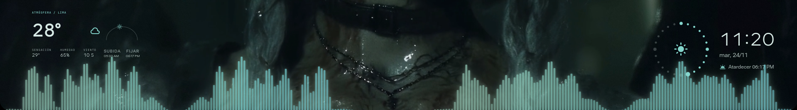
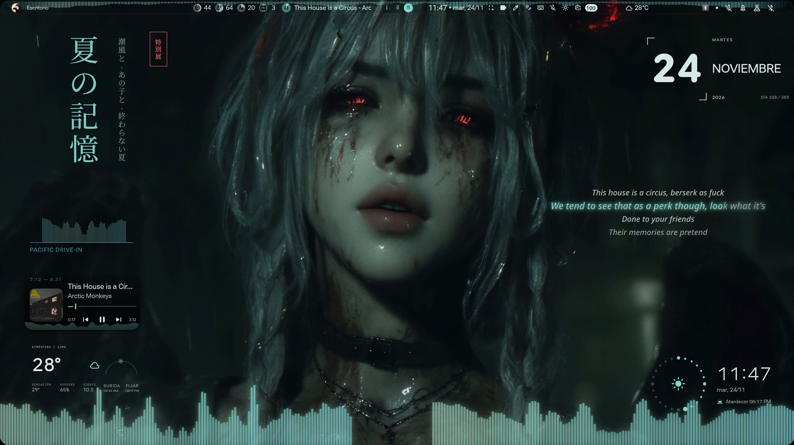
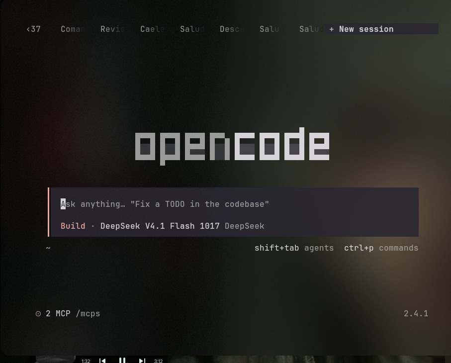
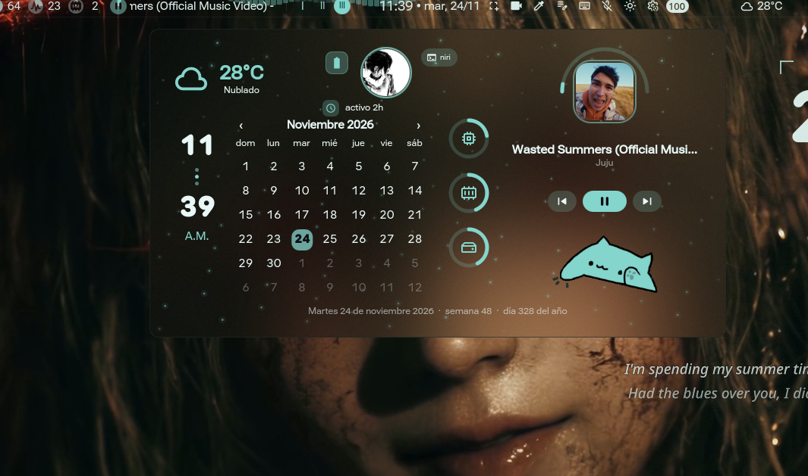
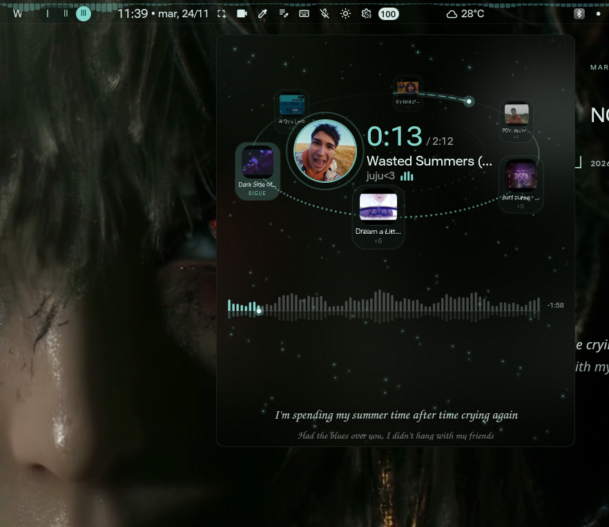
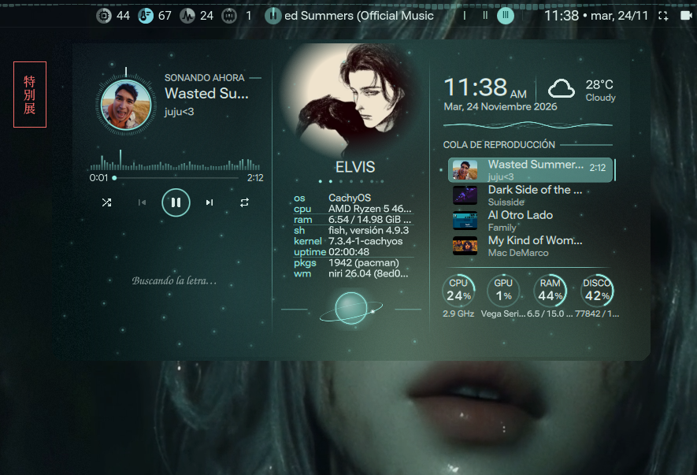
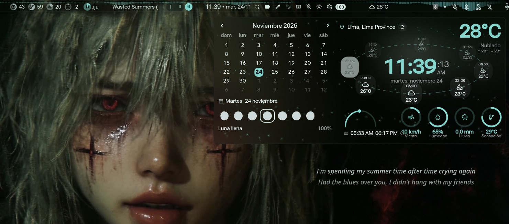
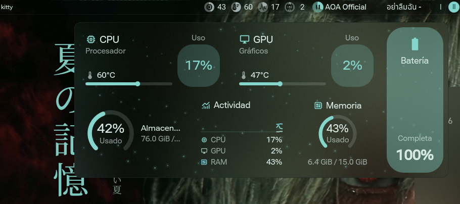

# inir-niri — mi escritorio en Linux

**[English](README.md)** · **[Русский](README.ru.md)**

Mi setup de **[inir](https://github.com/snowarch/iNiR)** + **niri** en CachyOS: widgets de música, letras en vivo en el escritorio y mis ajustes del shell.



## ¿Recién llegas? Lee esto primero

Este repo **no es un escritorio completo**: es *mi estética* (widgets, popups y configs)
para dos proyectos que son de otras personas.

| # | Qué necesitas | De dónde sale |
|---|---|---|
| 1 | **niri** — el compositor (las ventanas) | Se **instala**, no se clona: `sudo pacman -S niri` · [repo](https://github.com/YaLTeR/niri) |
| 2 | **iNiR** — el shell (barra, paneles, ajustes) | Se **clona**: [snowarch/iNiR](https://github.com/snowarch/iNiR) |
| 3 | **Esta estética** | Este repo 🙂 |

> ¿Usas otra distro? No hay problema: sigue la guía de iNiR
> ([inir.space/docs/install](https://inir.space/docs/install/)) para niri + iNiR,
> y después corre `./install.sh` de este repo. `bootstrap.sh` es solo para Arch/CachyOS.

### La forma fácil: un solo comando

`bootstrap.sh` revisa qué te falta, instala niri + iNiR si hace falta, y al final
aplica mi setup. No borra nada: lo que reemplaza queda en un backup.

```bash
git clone https://github.com/Elvislrd/inir-niri.git
cd inir-niri
./bootstrap.sh
```

Al terminar: **cierra sesión, vuelve a entrar eligiendo "niri"** y listo.

> ¿Prefieres que lo haga una IA? Copia el prompt de [`PROMPT.md`](PROMPT.md).

### La forma manual (si ya tienes niri + iNiR)

```bash
git clone https://github.com/Elvislrd/inir-niri.git
cd inir-niri
./install.sh
systemctl --user restart inir.service
```

### ¿Cuál uso?

| Tu situación | Comando |
|---|---|
| No tengo niri ni iNiR (o no estoy seguro) | `./bootstrap.sh` |
| Ya uso niri + iNiR y me funciona | `./install.sh` |

### Si algo falla

```bash
inir doctor      # revisa la instalación y arregla lo que pueda
inir logs        # muestra por qué no arrancó el shell
```

- Error de compilación (`makepkg`, `fakeroot`, `make`):
  `sudo pacman -S --needed base-devel`
- No puede clonar iNiR: revisa internet, o fija una versión con
  `./bootstrap.sh --ref v3.1.1`.
- El script deja el **log** y la copia de iNiR en `/tmp/...`: copia ese texto
  y se revisa.
- ¿Tienes iNiR pero tu shell no aparece? Cierra sesión y entra otra vez
  eligiendo **niri** en el login.

## Qué obtienes



Todo esto en **niri + inir**:

- Escritorio con **letra de la canción en vivo** y visualizador cava a lo ancho.
- **Barra** con reproductor, calendario, clima, recursos y batería.
- **5 popups** personalizados (panel de control, música, órbita, calendario, recursos).
- **Wallpaper Yami Luminas 1440p** incluido en `assets/wallpapers/`.
- Mi **config completa** de inir y niri.

## Recomendado: OpenCode + DeepSeek

Para editar estas configs sin pelear con QML, yo uso **OpenCode** con **DeepSeek**:



- Instalas OpenCode, eliges DeepSeek como modelo.
- Le pides en lenguaje normal: *“cambia la barra de música para que abra con clic”*.
- Él edita los `.qml`, tú reinicias el shell y listo.

## Qué incluye

### Widgets (código QML)
| Widget | Qué hace |
|---|---|
| **Visualizer** | Barras de espectro (cava) en la barra o el escritorio, reaccionan al audio real |
| **Media Controls** | Tarjeta con carátula, título, progreso y controles |
| **Lyrics** | Letra de la canción en el escritorio, palabra por palabra, línea actual iluminada |

Incluye las caras Iris (`IrisLyricsFace`, `IrisNowPlayingFace`) y los componentes de cava.

### Popups personalizados

| Captura | Archivo | Qué es |
|---|---|---|
|  | `popups/controlPanel/ControlPanelContent.qml` | Panel de control: clima, calendario, media, mascota |
|  | `popups/mediaControls/components/MediaOrbitPlayer.qml` | Reproductor en órbita con carátulas alrededor |
|  | `popups/mediaControls/components/MediaDashboardPlayer.qml` | Reproductor completo: carátula, info del sistema, cola |
|  | `popups/bar/ClockWidgetTooltip.qml` | Calendario + clima grande con fase lunar |
|  | `popups/bar/ResourcesPopup.qml` | CPU, GPU, RAM, disco y batería con medidores |

### Configuración
| Carpeta | Qué es |
|---|---|
| `config/inir/config.json` | Mi config completa del shell (barra, colores, paneles, atajos) |
| `config/inir/widgets/` | Posición, tamaño y opciones de cada widget del escritorio |
| `config/inir/desktop-profiles/` | Perfiles de escritorio guardados |
| `config/niri/` | Mi config de niri (`config.kdl` + `config.d/`) |
| `assets/wallpapers/` | Wallpaper **Yami Luminas 1440p** (video mp4) |

## Requisitos

- CachyOS / Arch (cualquier distro con niri sirve)
- **niri**
- **inir** shell (quickshell) 3.1.x
- **cava** — `sudo pacman -S cava`
- Nerd Fonts + `Z003` (la cursiva de la letra)
- Reproductor con MPRIS (mpv, Spotify, Firefox…)

## Qué hace `install.sh`

- Copia mis widgets, popups y configs **encima** de tu iNiR ya instalado.
- Hace **backup** de todo en `~/.config/inir-niri-backup/FECHA-HORA/`.
- No borra nada: solo copia encima.
- Las rutas `/home/USERNAME` se reemplazan por tu `$HOME` automáticamente.
- Si no encuentra iNiR, te avisa y te manda a `./bootstrap.sh`.

## Instalar solo los widgets (sin pisar tu config)

```bash
cp -r widgets/* ~/.config/quickshell/inir/modules/shared/background/widgets/
cp common/widgets/*.qml ~/.config/quickshell/inir/modules/common/widgets/
cp iris/widgets/*.qml ~/.config/quickshell/inir/modules/iris/widgets/
```

## Activar los widgets

1. Escritorio → **editar widgets**.
2. Añade **Visualizer**, **Media** y **Lyrics**.
3. Ajusta tamaño y posición; el visualizador puede ir a lo ancho de la pantalla.

## Wallpaper

```bash
cp assets/wallpapers/yami-luminas-1440p.mp4 ~/Imágenes/Wallpapers/
```

Luego lo eliges en los ajustes del shell.

## Notas

- ¿El visualizador no se mueve? Revisa que `cava` esté instalado y que el sink por defecto sea el de hardware.
- ¿No aparecen letras? La canción no está en LRCLIB; prueba otra.
- La letra puede usar la cursiva **Z003** (la misma del popup de música).

## Licencia

Uso libre. Comparte mejoras.

- El shell **iNiR** es de [snowarch](https://github.com/snowarch/iNiR), con licencia **GPL-3.0**.
- Mis configs y widgets se comparten bajo la misma licencia, porque varios archivos
  son derivados de iNiR. Ver [`NOTICE.md`](NOTICE.md).
