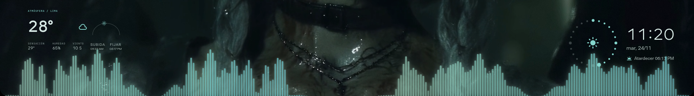
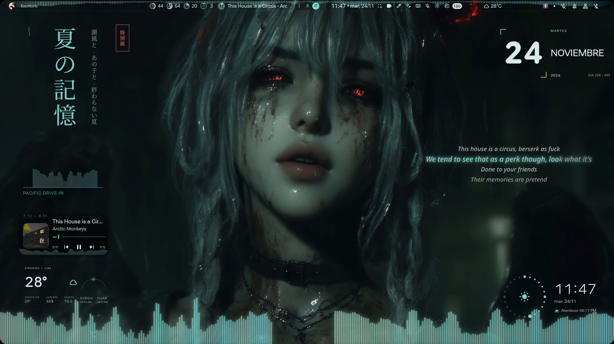
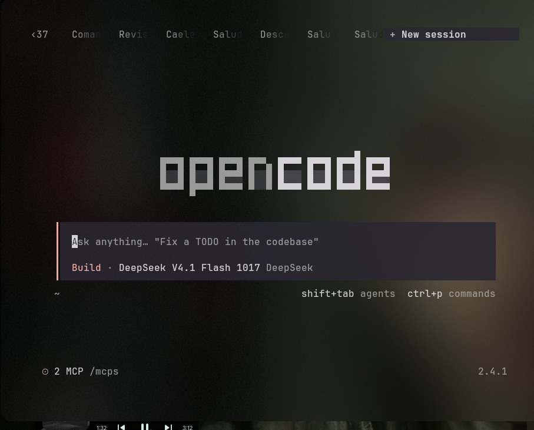
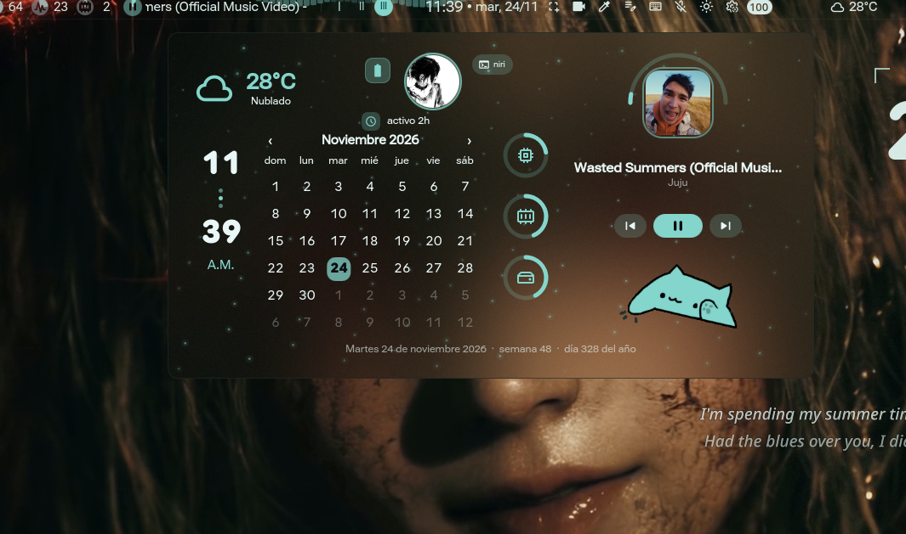
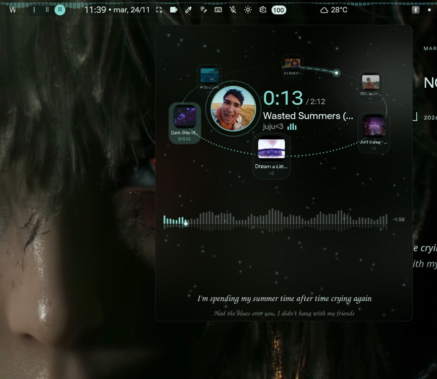
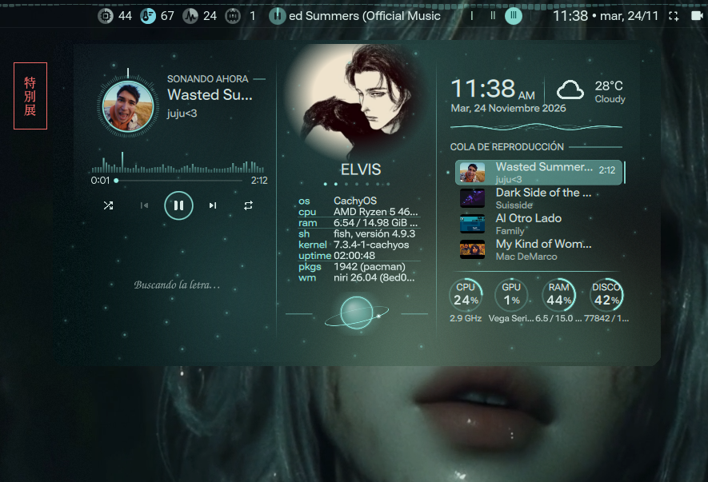
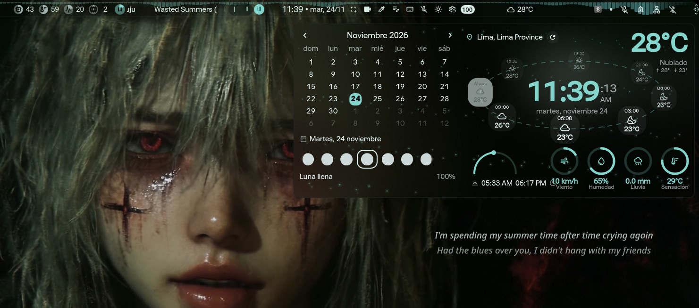

# inir-niri — my Linux desktop

**[Español](README.es.md)** · **[Русский](README.ru.md)**

My **[inir](https://github.com/snowarch/iNiR)** + **niri** setup on CachyOS: music widgets, live lyrics on the desktop and my shell tweaks.



## What you get



All of this running on **niri + inir**:

- Desktop with **live song lyrics** and a cava visualizer across the screen.
- **Bar** with player, calendar, weather, resources and battery.
- **5 custom popups** (control panel, music, orbit, calendar, resources).
- **Yami Luminas 1440p wallpaper** included in `assets/wallpapers/`.
- My **full config** for inir and niri.

## Recommended: OpenCode + DeepSeek

To edit these configs without fighting QML, I use **OpenCode** with **DeepSeek**:



- Install OpenCode, pick DeepSeek as the model.
- Ask in plain language: *"make the music bar open on click"*.
- It edits the `.qml`, you restart the shell, done.

## What's included

### Widgets (QML)
| Widget | What it does |
|---|---|
| **Visualizer** | Cava spectrum bars on the bar or desktop, driven by real audio |
| **Media Controls** | Card with cover art, title, progress and controls |
| **Lyrics** | Song lyrics on the desktop, word by word, current line highlighted |

Includes the Iris faces (`IrisLyricsFace`, `IrisNowPlayingFace`) and the cava components.

### Custom popups

| Screenshot | File | What it is |
|---|---|---|
|  | `popups/controlPanel/ControlPanelContent.qml` | Control panel: weather, calendar, media, mascot |
|  | `popups/mediaControls/components/MediaOrbitPlayer.qml` | Orbit player with covers around the current track |
|  | `popups/mediaControls/components/MediaDashboardPlayer.qml` | Full player: cover, system info, queue |
|  | `popups/bar/ClockWidgetTooltip.qml` | Calendar + big weather with moon phase |
|  | `popups/bar/ResourcesPopup.qml` | CPU, GPU, RAM, disk and battery gauges |

### Config
| Folder | What it is |
|---|---|
| `config/inir/config.json` | My full shell config (bar, colours, panels, keybinds) |
| `config/inir/widgets/` | Position, size and options of every desktop widget |
| `config/inir/desktop-profiles/` | Saved desktop profiles |
| `config/niri/` | My niri config (`config.kdl` + `config.d/`) |
| `assets/wallpapers/` | **Yami Luminas 1440p** wallpaper (video mp4) |

## Requirements

- CachyOS / Arch (any distro with niri works)
- **niri**
- **inir** shell (quickshell) 3.1.x
- **cava** — `sudo pacman -S cava`
- Nerd Fonts + `Z003` (cursive font used by the lyrics)
- Any MPRIS player (mpv, Spotify, Firefox…)

## Install

```bash
git clone https://github.com/Elvislrd/inir-niri.git
cd inir-niri
bash install.sh
systemctl --user restart inir.service
```

- Backs everything up to `~/.config/inir-niri-backup/DATE-TIME/`.
- Never deletes anything, only copies over.
- `/home/USERNAME` paths are replaced by your `$HOME` automatically.

## Widgets only (keep your own config)

```bash
cp -r widgets/* ~/.config/quickshell/inir/modules/shared/background/widgets/
cp common/widgets/*.qml ~/.config/quickshell/inir/modules/common/widgets/
cp iris/widgets/*.qml ~/.config/quickshell/inir/modules/iris/widgets/
```

## Turn the widgets on

1. Desktop → **edit widgets**.
2. Add **Visualizer**, **Media** and **Lyrics**.
3. Resize and place them; the visualizer can stretch across the whole screen.

## Wallpaper

```bash
cp assets/wallpapers/yami-luminas-1440p.mp4 ~/Pictures/Wallpapers/
```

Then pick it in your shell settings.

## Notes

- Visualizer not moving? Check `cava` is installed and the default sink is the hardware one.
- No lyrics? The track isn't on LRCLIB; try another song.
- Lyrics can use the **Z003** cursive (same as the music popup).

## License

Free to use. Share your improvements.
