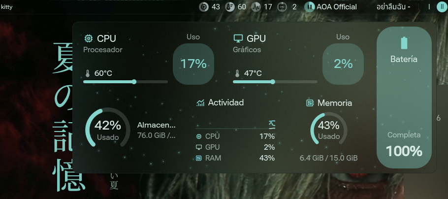

# inir-niri — mi escritorio en Linux

Configuración de **[inir](https://github.com/snowarch/iNiR)** + **niri** en CachyOS: widgets de música, letras en el escritorio y mis ajustes del shell.


## Qué incluye

### Widgets (código QML)
| Widget | Qué hace |
|---|---|
| **Visualizer** | Barras de espectro (cava) en la barra o el escritorio, reaccionan al audio real |
| **Media Controls** | Tarjeta con carátula, título, progreso y controles |
| **Lyrics** | Letra de la canción en el escritorio, palabra por palabra, línea actual iluminada |

Incluye las caras Iris (`IrisLyricsFace`, `IrisNowPlayingFace`) y los componentes de cava.

### Popups personalizados

| Captura | Archivo | Qué es |
|---|---|---|
|  | `popups/controlPanel/ControlPanelContent.qml` | Panel de control: clima, calendario, media, mascota |
|  | `popups/mediaControls/components/MediaOrbitPlayer.qml` | Reproductor en órbita con carátulas alrededor |
|  | `popups/mediaControls/components/MediaDashboardPlayer.qml` | Reproductor completo: carátula, info del sistema, cola |
|  | `popups/bar/ClockWidgetTooltip.qml` | Calendario + clima grande con fase lunar |
|  | `popups/bar/ResourcesPopup.qml` | CPU, GPU, RAM, disco y batería con medidores |

### Configuración
| Carpeta | Qué es |
|---|---|
| `config/inir/config.json` | Mi config completa del shell (barra, colores, paneles, atajos) |
| `config/inir/widgets/` | Posición, tamaño y opciones de cada widget del escritorio |
| `config/inir/desktop-profiles/` | Perfiles de escritorio guardados |
| `config/niri/` | Mi config de niri (`config.kdl` + `config.d/`) |

## Requisitos

- CachyOS / Arch
- niri
- inir shell (quickshell) 3.1.x
- `cava` — `sudo pacman -S cava`
- Reproductor con MPRIS (mpv, Spotify, Firefox…)

## Instalar

```bash
git clone https://github.com/Elvislrd/inir-niri.git
cd inir-niri
bash install.sh
systemctl --user restart inir.service
```

- Hace **backup** de todo en `~/.config/inir-niri-backup/FECHA-HORA/`.
- No borra nada: solo copia encima.
- Las rutas `/home/USERNAME` se reemplazan por tu `$HOME` automáticamente.

## Instalar solo los widgets (sin pisar tu config)

```bash
bash install.sh    # responde "no" si no quieres la config; o copia a mano:
cp -r widgets/* ~/.config/quickshell/inir/modules/shared/background/widgets/
cp common/widgets/*.qml ~/.config/quickshell/inir/modules/common/widgets/
cp iris/widgets/*.qml ~/.config/quickshell/inir/modules/iris/widgets/
```

## Activar los widgets

1. Escritorio → **editar widgets**.
2. Añade **Visualizer**, **Media** y **Lyrics**.
3. Ajusta tamaño y posición; el visualizador puede ir a lo ancho de la pantalla.

## Notas

- Si el visualizador no se mueve, revisa que `cava` exista y que el sink por defecto sea el de hardware.
- Si no aparecen letras, la canción no está en LRCLIB; prueba otra.
- La letra usa la cursiva **Z003** opcional (misma del popout de música).

## Licencia

Uso libre. Comparte mejoras.
