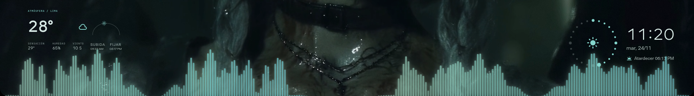
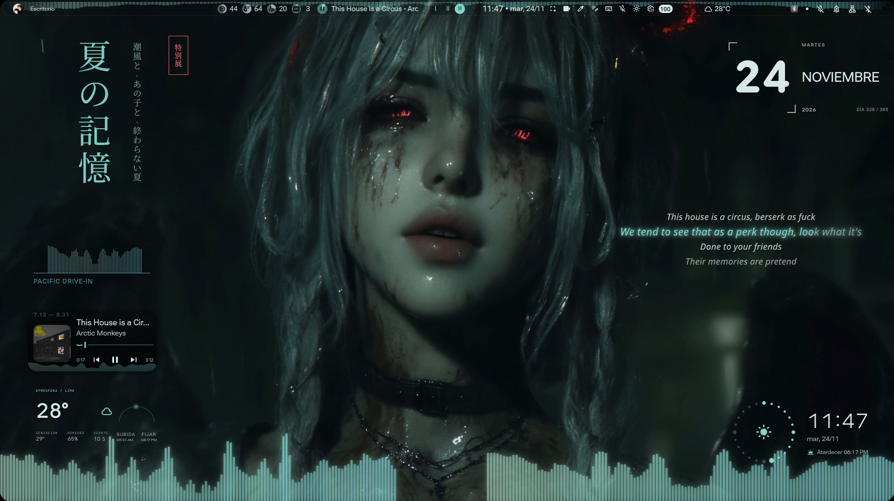
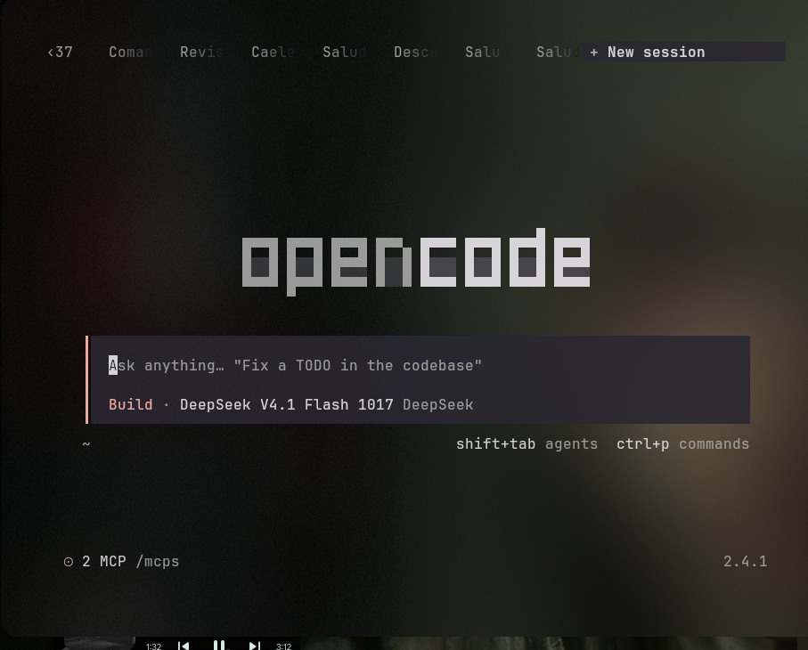
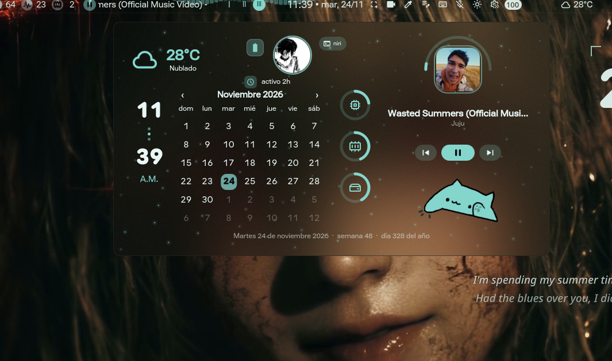
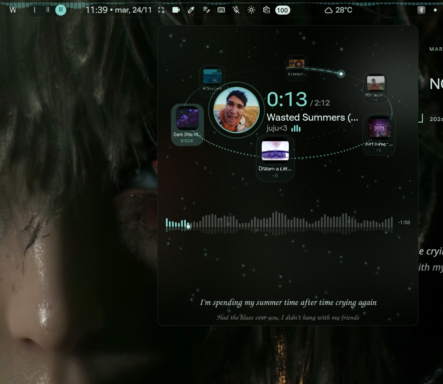
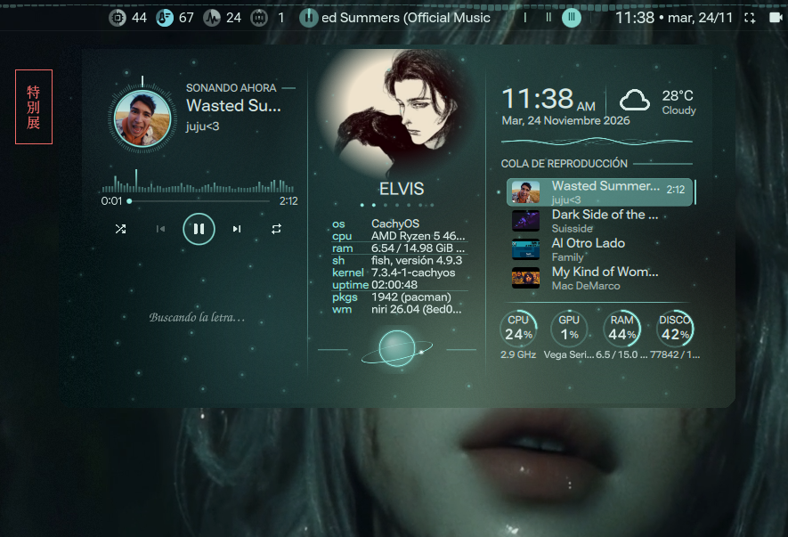
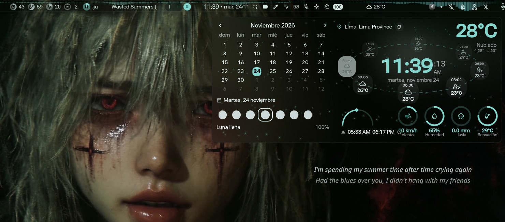
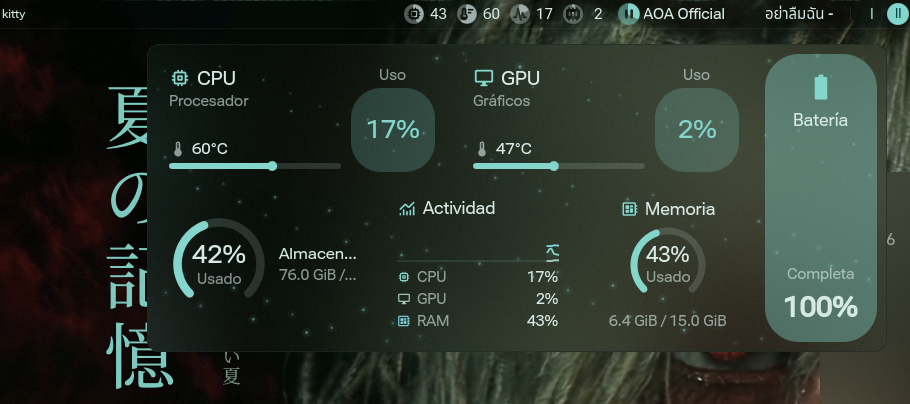

# inir-niri — мой рабочий стол на Linux

**[English](README.md)** · **[Español](README.es.md)**

Мой сетап **[inir](https://github.com/snowarch/iNiR)** + **niri** на CachyOS: музыкальные виджеты, живые тексты песен на рабочем столе и мои настройки шелла.



## Впервые здесь? Сначала прочитайте это

Этот репозиторий **не целый рабочий стол**: это *мой внешний вид* (виджеты, попапы
и конфиги) для двух проектов, которые сделали другие люди.

| # | Что нужно | Откуда берётся |
|---|---|---|
| 1 | **niri** — композитор (окна) | **Устанавливается**, не клонируется: `sudo pacman -S niri` · [репозиторий](https://github.com/YaLTeR/niri) |
| 2 | **iNiR** — шелл (панель, панели, настройки) | **Клонируется**: [snowarch/iNiR](https://github.com/snowarch/iNiR) |
| 3 | **Этот внешний вид** | Этот репозиторий 🙂 |

> Другой дистрибутив? Не проблема: следуйте руководству iNiR
> ([inir.space/docs/install](https://inir.space/docs/install/)) для niri + iNiR,
> потом запустите `./install.sh` из этого репозитория. `bootstrap.sh` — только Arch/CachyOS.

### Простой путь: одна команда

`bootstrap.sh` проверяет, чего не хватает, при необходимости ставит niri + iNiR
и в конце применяет мой сетап. Ничего не удаляет: всё заменённое уходит в бэкап.

```bash
git clone https://github.com/Elvislrd/inir-niri.git
cd inir-niri
./bootstrap.sh
```

В конце: **выйдите из сессии и войдите снова, выбрав «niri»** — готово.

> Хотите, чтобы это сделала ИИ? Скопируйте промпт из [`PROMPT.md`](PROMPT.md).

### Вручную (если niri + iNiR уже стоят)

```bash
git clone https://github.com/Elvislrd/inir-niri.git
cd inir-niri
./install.sh
systemctl --user restart inir.service
```

### Что выбрать?

| Ваша ситуация | Команда |
|---|---|
| Нет niri и iNiR (или не уверены) | `./bootstrap.sh` |
| niri + iNiR уже работают | `./install.sh` |

### Если что-то не работает

```bash
inir doctor      # проверяет установку и чинит что может
inir logs        # показывает, почему не запустился шелл
```

- Ошибка компиляции (`makepkg`, `fakeroot`, `make`):
  `sudo pacman -S --needed base-devel`
- Не клонируется iNiR: проверьте интернет или зафиксируйте версию:
  `./bootstrap.sh --ref v3.1.1`.
- Скрипт оставляет **лог** и копию iNiR в `/tmp/...`: пришлите этот текст.
- **Нет панели или виджетов?** Мой конфиг сделан для монитора `eDP-1`.
  `install.sh` определяет ваш и подставляет его; если не получилось (например,
  запускали не внутри niri), запустите снова из терминала в niri или проверьте
  `niri msg outputs` и Настройки → Экраны.
- iNiR есть, но шелла не видно? Выйдите и войдите снова, выбрав **niri**.

## Что вы получите



Всё это работает на **niri + inir**:

- Рабочий стол с **живым текстом песни** и визуализатором cava на всю ширину.
- **Панель** с плеером, календарём, погодой, ресурсами и батареей.
- **5 кастомных попапов** (панель управления, музыка, орбита, календарь, ресурсы).
- **Обои Yami Luminas 1440p** в `assets/wallpapers/`.
- Мой **полный конфиг** inir и niri.

## Рекомендую: OpenCode + DeepSeek

Чтобы править эти конфиги без борьбы с QML, я использую **OpenCode** с **DeepSeek**:



- Ставите OpenCode, выбираете модель DeepSeek.
- Пишете обычными словами: *«сделай, чтобы музыкальный попап открывался по клику»*.
- Он правит `.qml`, вы перезапускаете шелл — готово.

## Что внутри

### Виджеты (QML)
| Виджет | Что делает |
|---|---|
| **Visualizer** | Полосы спектра (cava) на панели или рабочем столе, реагируют на реальный звук |
| **Media Controls** | Карточка с обложкой, названием, прогрессом и кнопками |
| **Lyrics** | Текст песни на рабочем столе, слово за словом, текущая строка подсвечена |

Включает лица Iris (`IrisLyricsFace`, `IrisNowPlayingFace`) и компоненты cava.

### Кастомные попапы

| Скриншот | Файл | Что это |
|---|---|---|
|  | `popups/controlPanel/ControlPanelContent.qml` | Панель управления: погода, календарь, медиа, маскот |
|  | `popups/mediaControls/components/MediaOrbitPlayer.qml` | Плеер-орбита с обложками вокруг трека |
|  | `popups/mediaControls/components/MediaDashboardPlayer.qml` | Полный плеер: обложка, системная информация, очередь |
|  | `popups/bar/ClockWidgetTooltip.qml` | Календарь + большая погода с фазой луны |
|  | `popups/bar/ResourcesPopup.qml` | CPU, GPU, RAM, диск и батарея со шкалами |

### Конфиг
| Папка | Что это |
|---|---|
| `config/inir/config.json` | Мой полный конфиг шелла (панель, цвета, панели, бинды) |
| `config/inir/widgets/` | Позиция, размер и опции каждого виджета |
| `config/inir/desktop-profiles/` | Сохранённые профили рабочего стола |
| `config/niri/` | Мой конфиг niri (`config.kdl` + `config.d/`) |
| `assets/wallpapers/` | Обои **Yami Luminas 1440p** (видео mp4) |

## Требования

- CachyOS / Arch (подойдёт любой дистрибутив с niri)
- **niri**
- **inir** shell (quickshell) 3.1.x
- **cava** — `sudo pacman -S cava`
- Nerd Fonts + `Z003` (курсив для текста песен)
- Любой MPRIS-плеер (mpv, Spotify, Firefox…)

## Что делает `install.sh`

- Копирует мои виджеты, попапы и конфиги **поверх** уже установленного iNiR.
- Делает **бэкап** всего в `~/.config/inir-niri-backup/ДАТА-ВРЕМЯ/`.
- Ничего не удаляет, только копирует поверх.
- Пути `/home/USERNAME` автоматически заменяются на ваш `$HOME`.
- Если iNiR не найден, подскажет запустить `./bootstrap.sh`.

## Только виджеты (не трогая свой конфиг)

```bash
cp -r widgets/* ~/.config/quickshell/inir/modules/shared/background/widgets/
cp common/widgets/*.qml ~/.config/quickshell/inir/modules/common/widgets/
cp iris/widgets/*.qml ~/.config/quickshell/inir/modules/iris/widgets/
```

## Включить виджеты

1. Рабочий стол → **редактировать виджеты**.
2. Добавьте **Visualizer**, **Media** и **Lyrics**.
3. Подгоните размер и место; визуализатор можно растянуть на всю ширину.

## Обои

```bash
cp assets/wallpapers/yami-luminas-1440p.mp4 ~/Изображения/Wallpapers/
```

Потом выберите их в настройках шелла.

## Примечания

- Визуализатор не двигается? Проверьте, что `cava` установлен, а sink по умолчанию — аппаратный.
- Нет текста? Трека нет на LRCLIB — попробуйте другую песню.
- Для текста можно включить курсив **Z003** (как в музыкальном попапе).

## Лицензия

Свободно используйте. Делитесь улучшениями.

- Шелл **iNiR** принадлежит [snowarch](https://github.com/snowarch/iNiR), лицензия **GPL-3.0**.
- Мои конфиги и виджеты распространяются под той же лицензией, так как часть файлов
  является производной от iNiR. См. [`NOTICE.md`](NOTICE.md).
